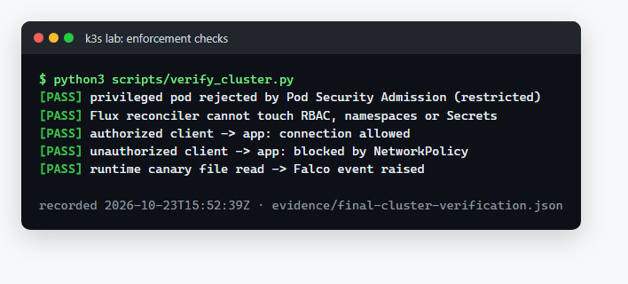
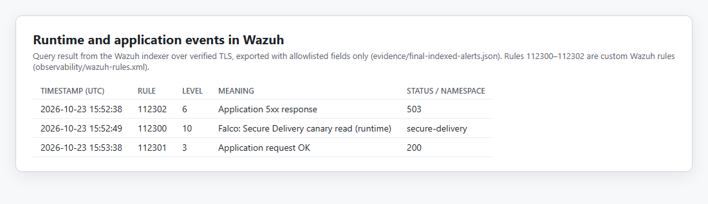
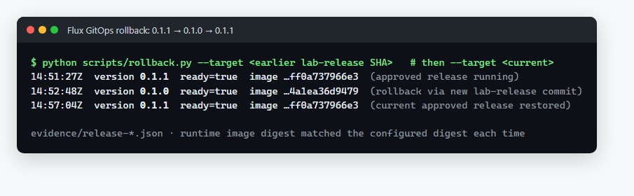
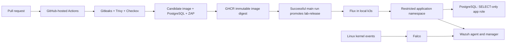

# Secure Cloud-Native Application Delivery

A local Kubernetes security lab that gates application releases, limits workload privileges,
and connects runtime detection to an existing Wazuh SOC lab.

[](https://github.com/benalifathia08-source/secure-delivery/actions/workflows/security.yaml)

**Verified on local hardware.** The delivery pipeline, workload restrictions, network isolation,
runtime detection, Wazuh indexing, database restore and GitOps rollback have been executed.
See the [validation ledger](docs/VALIDATION.md) for exact scope and observed results.

## Screenshots

The images are rendered from the saved CI report artifacts and the sanitized files in
[evidence/](evidence/README.md); nothing in them is mocked.

**A planted credential and a privileged pod are blocked; the clean candidate passes all 16 gates.**


**The live cluster enforces what the manifests declare.**



**Falco runtime events and application logs arrive in the Wazuh SOC lab.**



**Rollback is a Git commit, so Flux keeps it until the next approved release.**



## How it works



1. **Every change goes through a pull request.** `main` is protected: a passing `verify` check
   and a PR are required, including for administrators.
2. **Sixteen gates run on a disposable GitHub-hosted runner:** unit tests, lint, a repository
   policy check, Gitleaks on history and worktree, Trivy on dependencies, configuration, the
   rendered Kubernetes manifests and both images, Checkov, real negative fixtures that prove the
   scanners still catch planted problems, and an integration run against PostgreSQL with an
   OWASP ZAP scan. A finding *or* a scanner error blocks the release.
3. **Only the exact tested images are published**, to GHCR, and referenced by digest.
4. **Promotion is a commit to a separate `lab-release` branch** that only a successful `main` run
   can write. Flux, inside the lab, pulls that branch; CI never gets a kubeconfig or a network path
   into the lab.
5. **The workloads run restricted:** Pod Security Admission (restricted), non-root users,
   read-only root filesystems, dropped capabilities, resource limits, no service-account tokens,
   default-deny NetworkPolicies and a SELECT-only database role.
6. **Falco watches the node** with modern eBPF; its alerts and selected application logs are
   forwarded to the Wazuh SOC lab through custom rules 112300–112302.

The application is a deliberately small, read-only release inventory API (`/api/releases`,
`/health/live`, `/health/ready`), so the project is about delivery and runtime security, not the app.

## Results

| Demonstration | Observed result |
|---|---|
| Clean candidate | [Hosted gates passed](https://github.com/benalifathia08-source/secure-delivery/actions/runs/39972006316); both images promoted by digest |
| Synthetic credential and privileged manifest | [Demonstration PR rejected](https://github.com/benalifathia08-source/secure-delivery/pull/2), then closed without merging |
| Pod security and permissions | [Privileged pod and excess reconciler access denied](evidence/admission-rbac-runtime.json) |
| Network isolation | [Authorized client succeeded; unauthorized client blocked](evidence/network-isolation.json) |
| Runtime detection | [Falco canary alert reached Wazuh](evidence/runtime-detection.json), level 10 |
| Centralized telemetry | [Runtime and application events indexed](evidence/indexed-alerts.json) |
| Recovery | [Database restore tested](evidence/backup-restore.json); [0.1.1 → 0.1.0 rollback](evidence/release-after-rollback.json), then [0.1.1 restored](evidence/release-restored-current.json) |
| Ongoing maintenance | New base-image CVEs and expired exceptions blocked releases until fixed ([ADR-018](docs/DECISIONS.md)); Dependabot updates pass the same gates |

The runtime canary is a controlled sensitive-file-access simulation, not an exploit.

## Security design

- **Fail closed.** Security failures and scanner execution errors block publication and promotion.
- **Pin everything.** External actions use full commit SHAs; base and tool images use digests
  recorded in `tools.lock.json`; Flux controller images are pinned too.
- **Pull, don't push.** Flux watches `lab-release`; it never picks the newest registry image on its own.
- **Least privilege for the reconciler.** Flux's identity is namespace-scoped and cannot change
  RBAC, namespaces or Secrets.
- **No silent waivers.** Three narrow exceptions, each with a scope, owner, reason and expiry, are
  listed in [SECURITY.md](SECURITY.md). An expired exception fails the policy gate. No CVE is suppressed.
- **Detection is not enforcement.** Falco and Wazuh detect; Pod Security Admission and
  NetworkPolicy enforce.

The full [threat model](docs/THREAT_MODEL.md) lists the covered scenarios and what this design does
not protect against, such as a malicious repository administrator.

## Lessons learned

1. **"Done" is not a state for a security pipeline.** A month after release, new HIGH CVEs in
   Alpine system packages blocked every candidate, including Dependabot's, and the exceptions hit
   their expiry. Both were fixed without suppressing anything (ADR-018).
2. **Fix findings, don't move the threshold.** The first hosted run failed on unfixed HIGH and
   CRITICAL findings in the Debian base image; the fix was a different base image (ADR-006), not a
   lower severity bar.
3. **Remove what you don't use.** The PostgreSQL image shipped a vulnerable helper (`gosu`) that
   this deployment never needs. Deleting it fixed the finding instead of documenting it (ADR-013).
4. **Test the scanners themselves.** A scanner that crashes or is misconfigured can look like a pass.
   The negative fixtures prove on every run that Gitleaks, Trivy and Checkov still catch planted
   problems, and scanner errors fail the build.
5. **Scan what can reach production.** Scanning every branch let the deliberately insecure demo
   branch block clean releases; the gates now scan the candidate's own history (ADR-016).
6. **Least privilege needs written exceptions.** Flux genuinely needs to manage the app's
   NetworkPolicies; that permission is scoped, reviewed and recorded as EX-003, not hidden.

## Known limits

- Single-node local k3s lab: no public ingress, no high availability, no AWS/Azure deployment.
- Backups stay on the application VM, so they do not survive loss of that VM.
- Falco detects and alerts; it does not contain.
- Image rollback does not reverse database schema changes.
- Not yet done: a rebuild on a clean OS, off-host encrypted backups, scheduled rescans of the
  running images, and signed images with SBOMs and admission checks (for example Cosign with Kyverno).

## Run it yourself

**Checks on any machine** (Python 3.12 and uv 0.13.5):

```sh
uv sync --locked
uv run --locked pytest -q
uv run --locked ruff check .
uv run --locked python scripts/policy.py
# full 16-gate suite, on a disposable Linux host with Docker:
uv run --locked python scripts/ci.py
```

**The full lab** needs an Ubuntu VM (2 vCPU, 6 GiB RAM) and, for telemetry, a Wazuh 4.x server.
The scripts use pinned releases and verify checksums or APT signatures:

```sh
bash scripts/bootstrap_k3s.sh          # k3s with secrets encryption, no Traefik/ServiceLB
bash scripts/bootstrap_flux.sh         # pinned Flux controllers
sudo k3s kubectl apply -f deploy/platform/namespace.yaml -f deploy/platform/flux-rbac.yaml
python3 scripts/bootstrap_credentials.py
sudo k3s kubectl apply -f deploy/platform/flux-source.yaml
python3 scripts/bootstrap_credentials.py --provision
bash scripts/bootstrap_falco.sh        # signed Falco package, modern eBPF
sudo python3 scripts/install_wazuh_agent.py   # forward Falco + app events to Wazuh
python3 scripts/verify_cluster.py      # admission, RBAC, network and runtime checks
```

The [operations runbook](docs/OPERATIONS.md) covers each step, the Wazuh agent and rules,
backup and restore, rollback and restart. To run it from your own fork, change the GitRepository
URL and image locations. Database credentials are generated on the lab host and never stored in Git.

## Repository layout

```
.github/            workflow (16 gates + promotion), Dependabot, declared branch protection
app/                Flask release-inventory API (read-only)
deploy/base/        app, PostgreSQL, NetworkPolicies, limits (Kustomize base)
deploy/overlays/    lab overlay; CI rewrites its image digests on lab-release
deploy/platform/    namespace, scoped Flux RBAC and Git source (applied once)
observability/      Falco rules and output, Wazuh agent config and rules, log collector
security/           exception ledger, ZAP scan configuration
scripts/            ci.py and policy.py (gates), promote.py and rollback.py (delivery),
                    bootstrap_*.sh and verify_cluster.py (lab), backup_database.py (recovery)
tests/              unit tests for the app, policy check and promotion
evidence/           sanitized results behind every claim in this README
docs/               decisions, threat model, validation, operations, walkthrough, screenshots
Dockerfile          application image; database.Dockerfile: hardened PostgreSQL image
tools.lock.json     pinned actions, images and tool versions
```

More detail: [decisions](docs/DECISIONS.md) (18 ADRs), [validation](docs/VALIDATION.md),
[threat model](docs/THREAT_MODEL.md), [operations](docs/OPERATIONS.md),
[walkthrough](docs/DEMO.md), [security policy](SECURITY.md), [evidence index](evidence/README.md),
[changelog](CHANGELOG.md) and [primary references](docs/SOURCES.md).

## Credits and licences

This project is released under the [MIT License](LICENSE). It builds on these open-source tools;
none of their code is copied into this repository:

- Application: [Flask](https://flask.palletsprojects.com) (BSD-3-Clause),
  [Gunicorn](https://gunicorn.org) (MIT), [psycopg](https://www.psycopg.org) (LGPL-3.0),
  [PostgreSQL](https://www.postgresql.org) (PostgreSQL License)
- Pipeline: [GitHub Actions](https://github.com/features/actions),
  [Gitleaks](https://github.com/gitleaks/gitleaks) (MIT), [Trivy](https://trivy.dev) (Apache-2.0),
  [Checkov](https://www.checkov.io) (Apache-2.0), [OWASP ZAP](https://www.zaproxy.org) (Apache-2.0),
  [uv](https://docs.astral.sh/uv/) (MIT / Apache-2.0)
- Platform: [k3s](https://k3s.io) (Apache-2.0), [Flux](https://fluxcd.io) (Apache-2.0),
  [Falco](https://falco.org) (Apache-2.0), [Wazuh](https://wazuh.com) (GPLv2)
