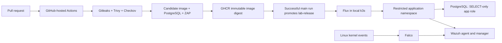

# Secure Cloud-Native Application Delivery

A local Kubernetes security lab that gates application releases, limits workload privileges,
and connects runtime detection to an existing Wazuh SOC lab.

[](https://github.com/benalifathia08-source/secure-delivery/actions/workflows/security.yaml)

**Verified on local hardware.** The delivery pipeline, workload restrictions, network isolation,
runtime detection, Wazuh indexing, database restore and GitOps rollback have been executed.
See the [status](docs/STATUS.md), [living backlog](docs/BACKLOG.md), and
[validation ledger](docs/VALIDATION.md) for exact scope and observed results.

## Demonstration results

| Demonstration | Observed result |
|---|---|
| Clean candidate | [Hosted gates passed](https://github.com/benalifathia08-source/secure-delivery/actions/runs/39972006316); both images promoted by digest |
| Synthetic credential and privileged manifest | [Demonstration PR rejected](https://github.com/benalifathia08-source/secure-delivery/pull/2), then closed without merging |
| Pod security and permissions | [Privileged pod and excess reconciler access denied](evidence/admission-rbac-runtime.json) |
| Network isolation | [Authorized client succeeded; unauthorized client blocked](evidence/network-isolation.json) |
| Runtime detection | [Falco canary alert reached Wazuh](evidence/runtime-detection.json), level 10 |
| Centralized telemetry | [Runtime and application events indexed](evidence/indexed-alerts.json) |
| Recovery | [Database restore tested](evidence/backup-restore.json); [0.1.1 → 0.1.0 rollback](evidence/release-after-rollback.json), then [0.1.1 restored](evidence/release-restored-current.json) |

The runtime canary is a controlled sensitive-file-access simulation. Three narrow, expiring
exceptions are documented in [SECURITY.md](SECURITY.md); no vulnerability suppression is used.

## Architecture



The application is a deliberately small, read-only release inventory API. It exposes
`/api/releases`, `/health/live` and `/health/ready`. Database failure affects readiness,
while liveness remains available. The application does not expose write endpoints.

## Security boundaries

- Disposable GitHub-hosted runners test pull requests; no runner has access to the lab.
- Security failures and scanner execution errors block publication and promotion.
- External actions use full commit SHAs; images use digests in `tools.lock.json`.
- The exact locally tested image is pushed after all gates pass.
- Only a successful main workflow can update the separate `lab-release` branch.
- Flux watches that branch; it does not select the newest registry image independently.
- Workloads use non-root identities, read-only roots, dropped capabilities, bounded resources,
  no mounted API tokens, and default-deny network policies.
- Falco detects suspicious runtime activity; network policies enforce connection restrictions.

## Local development

Requires Python 3.12 and uv 0.13.5. Linux and Docker are required for the complete gate suite.

```sh
uv sync --locked
uv run --locked pytest -q
uv run --locked ruff check .
uv run --locked python scripts/policy.py
# On a disposable Linux Docker host:
uv run --locked python scripts/ci.py
```

CI uses an ephemeral database with generated credentials. Kubernetes database credentials
must be generated on the lab host and stored outside Git. Do not deploy the unpromoted
application sentinel image from main.

## Project documentation

- [Backlog](docs/BACKLOG.md) — milestones, features and acceptance criteria.
- [Decisions](docs/DECISIONS.md) — choices and tradeoffs.
- [Validation](docs/VALIDATION.md) — observed results and pending checks.
- [Threat model](docs/THREAT_MODEL.md) — assumptions and limits.
- [Operations](docs/OPERATIONS.md) — bootstrap, verification and rollback.
- [Security policy](SECURITY.md) — gates, exceptions and reporting.
- [Environment](docs/ENVIRONMENT.md) — verified software and resource inventory.
- [Evidence index](evidence/README.md) — sanitized results and provenance.
- [Primary references](docs/SOURCES.md) — upstream documentation.

This project demonstrates cloud-native security on local hardware. It does not claim a
production cloud deployment, high availability, or protection against a cluster administrator.
